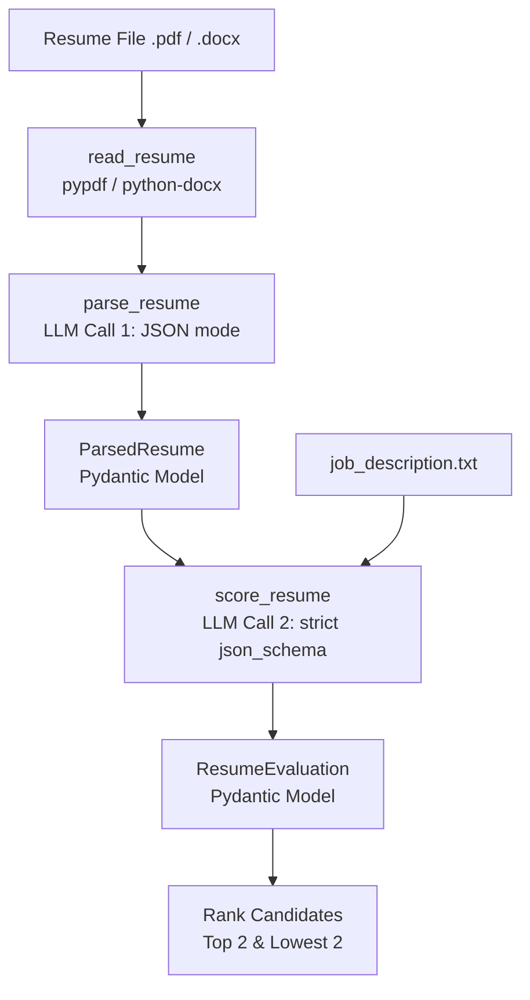

# 🤖 AI Resume Evaluator & Screener

[](https://www.python.org/)
[](https://groq.com/)
[](https://docs.pydantic.dev/)
[](https://github.com/astral-sh/uv)
[](LICENSE)

An LLM-powered recruiter screening pipeline that reads PDF/DOCX resumes, extracts structured candidate data into validated schemas, and scores applicants against a target job description using a deterministic 100-point rubric powered by the Groq API.

> 🎓 **Note:** Built as Week 1 of the **Padho AI Engineer** program.

---

## ✨ Features

- 📄 **Multi-Format Ingestion:** Seamlessly parses text from both `.pdf` (via `pypdf`) and `.docx` (via `python-docx`) files.
- 🧩 **Two-Stage Structured Pipeline:** Separates resume information extraction from candidate evaluation to ensure clean, grounded evaluations.
- 🛡️ **Guaranteed JSON Schema Outputs:** Leverages Pydantic v2 and Groq's structured output modes (`json_object` and `json_schema`) for reliable, hallucination-free outputs.
- 📊 **Objective Rubric Scoring:** Evaluates candidates across 4 key dimensions out of 100 points.
- ⚡ **Ultra-Fast Inference:** Powered by Groq Cloud inference using `openai/gpt-oss-20b` at `temperature=0`.
- 🏆 **Batch Candidate Ranking:** Iterates through batches of resumes and flags top-scoring and lower-scoring candidates for recruiter review.

---

## 🔄 How It Works



1. **Document Ingestion:** The script scans the candidate resume directory and loads files through `read_pdf` or `read_docx` based on file extension.
2. **Extraction Stage:** Raw resume text is processed by LLM Call 1 into structured attributes (name, email, skills, experience, education).
3. **Evaluation Stage:** The structured candidate profile is compared against the job description in LLM Call 2 with a 100-point scoring rubric.
4. **Summary & Ranking:** Results are collected and summarized to display top-ranking and lowest-ranking candidates.

---

## 🧠 How the LLM Calls Work

The pipeline makes two distinct LLM calls to keep concerns cleanly decoupled:

### 1. Extraction Call (`parse_resume`)
- **Model:** `openai/gpt-oss-20b`
- **Temperature:** `0` (deterministic, zero creativity)
- **Response Format:** `{"type": "json_object"}` (Groq JSON mode)
- **Prompts:**
  - **System Role:** Explicit instruction directing the model to extract structured data matching the `ParsedResume` schema without extra commentary.
  - **User Role:** Raw resume text (`Resume:\n{resume_text}`).
- **Validation:** Output JSON is parsed directly into the `ParsedResume` Pydantic model (`name`, `email`, `skills`, `experience_years`, `education`).

### 2. Evaluation Call (`score_resume`)
- **Model:** `openai/gpt-oss-20b`
- **Temperature:** `0`
- **Response Format:** Strict JSON schema enforcement via:
  ```python
  {
      "type": "json_schema",
      "json_schema": {"name": "resume_evaluation", "schema": ResumeEvaluation.model_json_schema()}
  }
  ```
- **Prompts:**
  - **System Role:** Rubric definition directing the model to evaluate the candidate across skills, experience, education, and clarity.
  - **User Role:** Clean JSON representation of `parsed_resume` alongside raw `job_description.txt`.
- **Validation:** Validated into the `ResumeEvaluation` Pydantic model (`score`, `strengths`, `weaknesses`, `suggestion`).

---

## 📋 Scoring Rubric

Candidates are assessed against [`job_description.txt`](job_description.txt) using the following 100-point rubric:

| Evaluation Criteria | Max Points | Description |
|:---|:---:|:---|
| **Skills Match** | 40 | Overlap with required languages, frameworks (e.g. PyTorch, Python, SQL), and ML tools |
| **Relevant Experience** | 35 | Years and depth of hands-on work building, optimizing, and deploying models |
| **Education & Projects** | 15 | Degree relevance (CS/Data Science) and practical applied projects/publications |
| **Resume Clarity** | 10 | Organization, readability, and articulation of achievements |
| **Total** | **100** | Overall candidate fit score |

---

## 🚀 Quick Start

Follow these steps to set up and run the evaluation pipeline locally:

### 1. Clone the repository
```bash
git clone https://github.com/ShiroOnigami23/ai-resume-evaluator.git
cd ai-resume-evaluator
```

### 2. Install dependencies with `uv`
Ensure you have [uv](https://docs.astral.sh/uv/) installed:
```bash
uv sync
```

### 3. Configure Environment Variables
Copy `.env.example` to `.env` and add your Groq API key:
```bash
cp .env.example .env
```
Open `.env` and paste your key:
```env
GROQ_API_KEY=gsk_your_actual_key_here
```

### 4. Add Resumes
Place the resumes you wish to evaluate inside a `resumes/` folder (or copy the provided sample resumes):
```bash
# On Linux / macOS
mkdir -p resumes && cp sample_resumes/* resumes/

# On Windows PowerShell
New-Item -ItemType Directory -Path "resumes" -Force
Copy-Item sample_resumes\* resumes\
```

### 5. Run the Evaluator
```bash
uv run python resume_evaluator.py
```

---

## 💻 Example Output

Here is the real terminal execution output running on the sample resumes:

```text
$ uv run python resume_evaluator.py
Processing alex_chen.docx...
<class 'groq.types.chat.chat_completion.ChatCompletion'>

TOP 2
Processing david_kim.docx...
<class 'groq.types.chat.chat_completion.ChatCompletion'>

TOP 2
Processing priya_rao.pdf...
<class 'groq.types.chat.chat_completion.ChatCompletion'>

TOP 2
Processing sarah_connor.docx...
<class 'groq.types.chat.chat_completion.ChatCompletion'>

TOP 2
Alex Chen - 48
David Kim - 13

LOWEST 2
Priya Rao - 81
Sarah Connor - 78
```

---

## 📁 Project Structure

```text
ai-resume-evaluator/
├── .env.example              # Template for required environment variables
├── .gitignore                 # Excludes .env, virtualenvs, cache, and candidate resumes
├── assets/
│   └── terminal_output.txt    # Captured raw terminal execution output
├── job_description.txt        # Target job role description (TechNova Analytics ML Engineer)
├── pyproject.toml             # Project dependencies and metadata
├── README.md                  # Comprehensive documentation
├── resume_evaluator.py        # Core extraction and evaluation script
├── sample_resumes/            # Synthetic sample resumes for testing
│   ├── alex_chen.docx
│   ├── david_kim.docx
│   ├── priya_rao.pdf
│   └── sarah_connor.docx
└── uv.lock                    # Dependency lockfile generated by uv
```

---

## 💡 What I Learned

- **Structured Outputs vs Prompt Begging:** Defining strict JSON schemas via Pydantic and passing them directly to Groq's API eliminates JSON parsing failures and schema inconsistencies.
- **Two-Stage LLM Architecture:** Splitting information extraction from scoring ensures the evaluation prompt is focused, grounded, and significantly faster.
- **Multi-Format Text Extraction:** Handling both modern `.docx` XML structures and `.pdf` streams reliably within a unified router function.
- **Fast Reproducibility with uv:** Using `uv` for lightning-fast dependency resolution and virtual environment isolation.

---

## 🔮 Future Work

- [ ] **Interactive Web UI:** Build a clean [Streamlit](https://streamlit.io/) interface for drag-and-drop resume uploading, real-time rubric customization, and visual candidate comparisons.
- [ ] **Automated Candidate Feedback:** Generate automated, personalized feedback emails for rejected and shortlisted candidates based on model suggestions.
- [ ] **Batch Export:** Export evaluation matrices to CSV / Notion / ATS webhooks.
